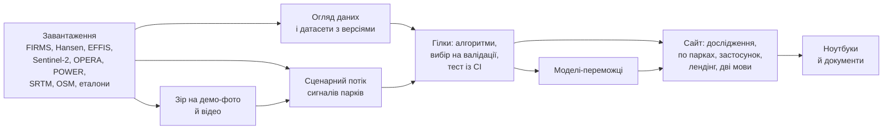

# Архітектура

Як влаштовано дослідження «Ліси Фракії»: бібліотека EagleWings рахує все за реєстром гілок, а тека проєкту тримає конфіг, дані, результати й сайт. Таблиці нижче генерує `scripts/build_docs.py` з коду й даних; прозу поза ними пише людина або Claude.

## Потік

Порядок і залежності задає потік Prefect (`flows/pipeline.py` бібліотеки): задачі йдуть по одній; якщо задача падає, залежні від неї пропускаються, а потік наприкінці стає червоним. Кожен прогін записує версію в `data/runs/`: усі метрики, переможців, датасети й різницю з попередньою версією. З `--clearml` запуски, датасети й моделі пишуться в ClearML.

## Де що лежить

| Місце | Що там |
|---|---|
| бібліотека `src/eaglewings/` | `ds/branches.py` (реєстр гілок), `ds/tasks/` (задача кожної гілки), `ds/datasets.py` (датасети з версіями), `scripts/` (кроки потоку), `flows/pipeline.py`, `assistant/` (агент чату), шаблони сторінок |
| проєкт `config/` | `regions.py` — парки, роки, джерела; `branches.py` — увімкнені гілки (`ACTIVE`); `media.py` — фото й відео |
| проєкт `data/` | `raw/` сирі дані, `datasets/` датасети з `manifest.json`, `processed/` результати, `runs/` версії прогону |
| проєкт `models/`, `notebooks/`, `web/`, `docs/`, `artifacts/` | моделі-переможці з картками, ноутбуки, сайт, документи, звіти потоку |

**Кілька парків.** Датасет місця збирається для кожного парку й зливається з колонкою `park`; переможця обирає валідація всіх парків разом, а тест рахується разом і окремо по парках. Застосунок перемикає парк: моніторинг, аналітика, мапа й чат показують вибраний парк; розділи, яких у парку немає, ховаються.

**Застосунок.** Статична сторінка: моніторинг (ареали, супутник, камери, фотопастки, гаряча лінія), аналітика (мапа результатів гілок), чат з агентом. Потік сигналів моніторингу сценарний, на реальних місцях парку (`scripts/03_signals.py`); ареали будуються з подій після зведення сигналів і перевірені гілкою AS.

**Агент.** Окремий сервер (`eaglewings assistant`, порт 8770) відповідає на питання звичайною мовою над таблицями парку нижче: таблиця, число, графік і об'єкти на мапі.

## Кроки потоку

<!-- auto:steps -->
|  | Крок | Задачі |
|---|---|---|
| 1 | **data** — Завантаження сирих даних → data/raw/, data/processed/ | `fetch` межа парку, дороги, FIRMS, Hansen, знімки ділянок `bench` еталони D-Fire, VEDAI, ENA24 і згарища EFFIS |
| 2 | **vision** — Комп'ютерний зір на справжніх фото, відео й знімках (GPU) → data/processed/vision/ | `vision` детектори на фото й відео, маски на знімках |
| 3 | **mocks** — Моки: сценарний потік сигналів демо, бере справжній дим із vision → signals.csv, ops.json | `mocks` генератор потоку сигналів демо |
| 4 | **eda** — EDA сирих наборів одразу після завантаження й моків → data/processed/eda/sources/ | `eda` EDA сирих наборів: що в кожному, розподіли, час, мапи |
| 5 | **datasets** — Датасети з сирих даних, кожен своєю функцією збору, і їхня EDA → data/datasets/, data/processed/eda/datasets/ | `datasets` датасети з сирих даних і їхня EDA |
| 6 | **core** — Задачі без GPU → data/datasets/, logs/runs/, experiments_summary.json | `t1` FD · що згоріло у 2023 `t13` FM · які точки це одна пожежа `t2` FG · день пожежі `t3` FG · ризик ділянок `t5` FG · поширення фронту `t21` AR · де пожежі повторюються `t19_ld` LD · рубка на знімках `t19_lm` LM · збіг Sentinel-2 і OPERA `t19_lg` LG · де рубатимуть `t23` TP · де ставити вежі `t24` CP · де ставити камери `t22` CG · камера на координати (сценарний аналіз) `t20` XM · зведення сигналів (симуляція) `t25` AS · зони інтересу (симуляція) |
| 7 | **cv** — Задачі детекторів на GPU → те саме | `t11` SD · машини згори на VEDAI `t18` CD · дим і вогонь на D-Fire, машини на ENA24 `t4` демо детекторів, без метрик |
| 8 | **models** — Моделі-переможці кожної гілки → models/<код>/, з --clearml ще ClearML Model Registry | `models` моделі-переможці |
| 9 | **site_data** — Дані для сайту з готових результатів → web/science/*.json, web/app.html (нічого не рахує) | `science` сторінка досліджень: data, extra, spread `app_extra` дані для застосунку `more` сторінка досліджень: more `sources` вкладка «Набори даних»: опис з EDA `maps` вкладка «Набори даних»: мапи з EDA `ds_eda` вкладка «Датасети»: EDA датасетів `science_page` сторінка досліджень із шаблону: розділи гілок з реєстру `parks_page` сторінка досліджень: по парках (метрики й мапи кожного парку) `answers` відповіді чату застосунку `page` сторінка застосунку web/app.html `app_recordings` записи застосунку для лендінгу `landing_parks` мапи парків першого екрана лендінгу й слайди `landing` лендінг з каркаса й блоків, записи застосунку в блоці views `i18n` дві мови: копії сторінок у web/ua/ і web/en/ зі скриптом перекладу |
| 10 | **notebooks** — Ноутбуки, що повторюють сторінку досліджень → notebooks/ | `notebooks` ноутбуки |
| 11 | **docs** — Документи з коду: схема архітектури й таблиця гілок → artifacts/ (пояснення переписує Claude, коли код змінився) | `docs` схема архітектури й таблиця гілок з коду й результатів |
<!-- /auto:steps -->

## Гілки

<!-- auto:branches -->
| Код | Назва | Питання | Група | Датасети | Увімкнена |
|---|---|---|---|---|---|
| **FD** | FD · що згоріло у 2023 | Що саме згоріло у 2023 році і скільки? | Пожежі · виміряно | `burned_area_pixels` | так |
| **FM** | FM · які точки це одна пожежа | Які теплові точки з двох супутників це одна пожежа? | Пожежі · виміряно | `matching_firms_effis` | так |
| **FG_day** | FG · день пожежі | Чи можна за погодою заздалегідь виділити дні з пожежами? | Пожежі · виміряно | `fire_day_daily` | так |
| **FG_risk** | FG · ризик ділянок | Які ділянки парку згорять наступними? | Пожежі · виміряно | `h3_risk_cells` | так |
| **FG_spread** | FG · поширення фронту | Куди піде фронт пожежі за добу? | Пожежі · виміряно | `fire_spread_cells` | так |
| **AR** | AR · де пожежі повторюються | Де пожежі повторюються на тих самих місцях? | Пожежі · виміряно | `ar_fires` | так |
| **LD** | LD · рубка на знімках | Чи видно рубку на знімках Sentinel-2, коли рубок мало? | Вирубка · виміряно | `logging_gr_pixels` | так |
| **LM** | LM · збіг Sentinel-2 і OPERA | Чи точніший збіг Sentinel-2 і NASA OPERA, ніж одне джерело? | Вирубка · виміряно | `logging_gr_pixels`, `opera_gr_snapshots` | так |
| **LG** | LG · де рубатимуть | Де рубатимуть наступного року? | Вирубка · виміряно | `logging_gr_cells` | так |
| **TP** | TP · де ставити вежі | Де поставити вежі, щоб побачити найбільше майбутніх пожеж? | Сценарний аналіз | `h3_risk_cells`, `tp_fires`, `tp_candidates` | так |
| **CP** | CP · де ставити камери | Через які місця на дорогах проходить під'їзд до рубок? | Сценарний аналіз | `logging_gr_cells`, `cp_events` | так |
| **CG** | CG · камера на координати (сценарний аналіз) | Де на мапі дим, якщо камера бачить лише напрямок? | Сценарний аналіз | `h3_risk_cells`, `cv_camera_zone` | так |
| **XM** | XM · зведення сигналів (симуляція) | Як звести сигнали з різних джерел в одну подію? | Симуляція | `xm_signals` | так |
| **AS** | AS · зони інтересу (симуляція) | Які зони інтересу є в парку, якого типу, з якими рисами в часі й просторі і з яких джерел? | Симуляція | `as_areals` | так |
| **SD** | SD · машини згори на VEDAI | Чи видно машини згори і за якої роздільності? | Детектори · виміряно | `cv_benchmark_aerial` | так |
| **CD** | CD · дим і вогонь на D-Fire, машини на ENA24 | Наскільки точно готові моделі бачать дим і вогонь на фото? | Детектори · виміряно | `cv_benchmark_ground` | так |
<!-- /auto:branches -->

## Датасети

<!-- auto:datasets -->
| Датасет | Версія | Рядків | Одиниця | Джерела |
|---|---|---|---|---|
| `ar_fires` | v1 | 8 268 | пожежа після зведення FM | NASA FIRMS VIIRS, MODIS |
| `as_areals` | v1 | 36 000 | сценарій × прогін × підхід | симуляція застосунку, OpenStreetMap |
| `burned_area_pixels` | v1 | 493 181 | піксель Hansen 30 м (ліс у парку) | Hansen GFC v1.12 (UMD/NASA), MODIS MOD13Q1 v061 (ORNL DAAC), OSM park boundary |
| `burned_area_pixels_dadia` | v1 | 438 001 | піксель Hansen 30 м (ліс у парку) | Hansen GFC v1.12 (UMD/NASA), MODIS MOD13Q1 v061 (ORNL DAAC), OSM park boundary |
| `burned_area_pixels_emt` | v1 | 37 647 | піксель Hansen 30 м (ліс у парку) | Hansen GFC v1.12 (UMD/NASA), MODIS MOD13Q1 v061 (ORNL DAAC), OSM park boundary |
| `burned_area_pixels_evros_delta` | v1 | 17 533 | піксель Hansen 30 м (ліс у парку) | Hansen GFC v1.12 (UMD/NASA), MODIS MOD13Q1 v061 (ORNL DAAC), OSM park boundary |
| `cp_events` | v1 | 143 | подія: рубка або пожежа | Hansen GFC, NASA FIRMS, OpenStreetMap |
| `cv_benchmark_aerial` | v1 | 6 177 | кадр еталонного набору | VEDAI |
| `cv_benchmark_ground` | v1 | 5 643 | кадр еталонного набору | D-Fire, ENA24 / LILA BC |
| `cv_camera_zone` | v1 | 1 550 | гекс із пожежею за рік | NASA FIRMS, SRTM |
| `fire_day_daily` | v1 | 5 478 | доба (зона парку + 3 км) | NASA POWER daily (AG community), NASA FIRMS VIIRS S-NPP + MODIS |
| `fire_day_daily_dadia` | v2 | 1 826 | доба (зона парку + 3 км) | NASA POWER daily (AG community), NASA FIRMS VIIRS S-NPP + MODIS |
| `fire_day_daily_emt` | v1 | 1 826 | доба (зона парку + 3 км) | NASA POWER daily (AG community), NASA FIRMS VIIRS S-NPP + MODIS |
| `fire_day_daily_evros_delta` | v1 | 1 826 | доба (зона парку + 3 км) | NASA POWER daily (AG community), NASA FIRMS VIIRS S-NPP + MODIS |
| `fire_spread_cells` | v1 | 136 897 | (пожежа, момент t, гекс H3 res 8 у радіусі 12 км від згарища) | NASA FIRMS VIIRS S-NPP (Greece 2021–2025), NASA POWER hourly, AWS Terrain Tiles (SRTM), Hansen GFC v1.12 |
| `h3_risk_cells` | v1 | 13 344 | комірка H3 res 9 у парку | Hansen GFC v1.12, NASA FIRMS, MODIS MOD13Q1, AWS Terrain Tiles (SRTM), OpenStreetMap |
| `h3_risk_cells_dadia` | v1 | 3 664 | комірка H3 res 9 у парку | Hansen GFC v1.12, NASA FIRMS, MODIS MOD13Q1, AWS Terrain Tiles (SRTM), OpenStreetMap |
| `h3_risk_cells_emt` | v1 | 8 070 | комірка H3 res 9 у парку | Hansen GFC v1.12, NASA FIRMS, MODIS MOD13Q1, AWS Terrain Tiles (SRTM), OpenStreetMap |
| `h3_risk_cells_evros_delta` | v1 | 1 610 | комірка H3 res 9 у парку | Hansen GFC v1.12, NASA FIRMS, MODIS MOD13Q1, AWS Terrain Tiles (SRTM), OpenStreetMap |
| `logging_gr_cells` | v1 | 106 752 | гекс H3 res 9 × рік | Hansen GFC v1.12, SRTM, OpenStreetMap, EFFIS, NASA FIRMS |
| `logging_gr_cells_dadia` | v1 | 29 312 | гекс H3 res 9 × рік | Hansen GFC v1.12, SRTM, OpenStreetMap, EFFIS, NASA FIRMS |
| `logging_gr_cells_emt` | v1 | 64 560 | гекс H3 res 9 × рік | Hansen GFC v1.12, SRTM, OpenStreetMap, EFFIS, NASA FIRMS |
| `logging_gr_cells_evros_delta` | v1 | 12 880 | гекс H3 res 9 × рік | Hansen GFC v1.12, SRTM, OpenStreetMap, EFFIS, NASA FIRMS |
| `logging_gr_pixels` | v1 | 374 482 | піксель лісу 30 м × рік | Sentinel-2 L2A (AWS Earth Search), Hansen GFC v1.12, SRTM, EFFIS, NASA FIRMS |
| `logging_gr_pixels_dadia` | v1 | 178 181 | піксель лісу 30 м × рік | Sentinel-2 L2A (AWS Earth Search), Hansen GFC v1.12, SRTM, EFFIS, NASA FIRMS |
| `logging_gr_pixels_emt` | v1 | 156 049 | піксель лісу 30 м × рік | Sentinel-2 L2A (AWS Earth Search), Hansen GFC v1.12, SRTM, EFFIS, NASA FIRMS |
| `logging_gr_pixels_evros_delta` | v1 | 40 252 | піксель лісу 30 м × рік | Sentinel-2 L2A (AWS Earth Search), Hansen GFC v1.12, SRTM, EFFIS, NASA FIRMS |
| `matching_firms_effis` | v1 | 41 630 | супутниковий сигнал про вогонь (VIIRS або MODIS) | NASA FIRMS VIIRS S-NPP, MODIS, EFFIS Burnt Areas (Copernicus) |
| `opera_gr_snapshots` | v1 | 84 | знімок стану OPERA на дату | NASA OPERA L3 DIST-ALERT-HLS через NASA GIBS |
| `opera_gr_snapshots_dadia` | v1 | 28 | знімок стану OPERA на дату | NASA OPERA L3 DIST-ALERT-HLS через NASA GIBS |
| `opera_gr_snapshots_emt` | v1 | 28 | знімок стану OPERA на дату | NASA OPERA L3 DIST-ALERT-HLS через NASA GIBS |
| `opera_gr_snapshots_evros_delta` | v1 | 28 | знімок стану OPERA на дату | NASA OPERA L3 DIST-ALERT-HLS через NASA GIBS |
| `tp_candidates` | v1 | 754 | місце для вежі | SRTM |
| `tp_candidates_dadia` | v1 | 300 | місце для вежі | SRTM |
| `tp_candidates_emt` | v1 | 300 | місце для вежі | SRTM |
| `tp_candidates_evros_delta` | v1 | 154 | місце для вежі | SRTM |
| `tp_fires` | v1 | 348 | пожежа після зведення FM | NASA FIRMS VIIRS, MODIS, SRTM |
| `tp_fires_dadia` | v1 | 25 | пожежа після зведення FM | NASA FIRMS VIIRS, MODIS, SRTM |
| `tp_fires_emt` | v1 | 267 | пожежа після зведення FM | NASA FIRMS VIIRS, MODIS, SRTM |
| `tp_fires_evros_delta` | v1 | 56 | пожежа після зведення FM | NASA FIRMS VIIRS, MODIS, SRTM |
| `xm_signals` | v1 | 335 | сигнал потоку демо | симуляція демо, NASA FIRMS, OpenStreetMap |
<!-- /auto:datasets -->

## Таблиці агента

<!-- auto:assistant -->
| Таблиця | Що в ній |
|---|---|
| `areals` | Ареали парку за 90 днів демо-потоку: зони повторюваних подій одного типу (type: fire/logging/vehicle) |
| `signals` | Окремі сигнали демо-потоку за 90 днів: камера, фотопастка, супутник, соцмережі, гаряча лінія / експерт |
| `events` | Події: сигнали одного типу за день, зведені в одну подію (DBSCAN). |
| `fires` | Справжні теплові точки NASA FIRMS (VIIRS і MODIS) у парку й 3 км довкола, 2021–2025 |
| `risk_cells` | Гекси парку (H3 res 9, ~0,1 км²): ризик пожежі на 2026 рік і що горіло раніше |
| `logging_candidates` | Ділянки-кандидати на рубку: супутник Sentinel-2 бачить падіння вологості крон поза згарищами |
| `forest_loss` | Втрата лісу Hansen Global Forest Change у парку й 3 км довкола: кожен рядок — піксель ~30 м, де ліс зник у році year (2001–2024) |
| `weather_days` | Кожен день 2021–2025 у кожному парку: погода NASA POWER у точці парку, індекси пожежної небезпеки й чи була пожежа за FIRMS. |
| `research_results` | Результати дослідження: кожен рядок — алгоритм однієї гілки (питання дослідження), метрика на валідації (val, нею обирали переможця) і на тесті (test) з 95 % CI |
| `roads` | Дороги OSM у парку й довкола; лінію сервер показує за id |
| `park` | Межа національного парку (один рядок, id PARK). |
| `detections` | Об'єкти, які детектори (YOLO, GroundingDINO) знайшли на фото й відео демо з Дадьї та інших місць |
| `hex_features` | Повний датасет гексів H3 res 9 парку для прогнозу ризику: рельєф, паливо, люди, історія пожеж і втрат |
| `hex_logging_years` | Гекси H3 res 9 × рік (2017–2024) для прогнозу рубок: історія втрат лісу поза згарищами |
| `burned_area_pixels` | Пікселі лісу парку ~30 м для задачі згарища 2023: NDVI MODIS до й після пожежі, лейбл втрати Hansen |
| `logging_pixels` | Пікселі лісу ~30 м × рік для детекції рубок Sentinel-2 без згарищ: смуги й індекси до/після, лейбл Hansen |
| `opera_snapshots` | NASA OPERA DIST-ALERT над парком: на кожну дату скільки пікселів (30 м) у кожному статусі порушення рослинності. |
| `benchmark_images` | Кадри незалежних еталонів, на яких міряли детектори: VEDAI (машини згори), D-Fire (дим і вогонь), ENA24 (фотопастки) |
| `fire_spread` | Поширення пожеж Греції 2021–2025: гекси H3 res 8 довкола активної пожежі в момент t з ознаками фронту, вітру, рельєфу й палива |
| `fires_greece` | Пожежі Греції 2021–2025 за FIRMS, зведені з точок правилом переможця FM (2 км, 5 діб) |
| `firms_vs_effis` | Теплові точки FIRMS Греції 2021–2025 з позначкою, чи лежать у згарищі EFFIS: на цьому перевіряли, які точки це одна пожежа (FM) |
| `tower_sites` | Місця-кандидати для веж спостереження в кожному парку: найвищі гекси на відстані від 1 км і скільки гексів видно з кожного (рельєф SRTM) |
| `tower_fires` | Пожежі кожного парку 2021–2025 з перших точок FIRMS: на них перевіряли, чи бачили б їх вежі. |
| `road_events` | Нові втрати лісу поза згарищами й пожежі основного парку (Дадья): місця, до яких перевіряли під'їзд дорогами для камер |
| `camera_zone` | Гекси основного парку (Дадья) з точками FIRMS 2022 і 2023: справжні місця для перевірки зони камери |
| `signals_benchmark` | Потік сигналів основного парку (Дадья) з еталоном для зведення сигналів (XM): сценарій і день генератора |
<!-- /auto:assistant -->
